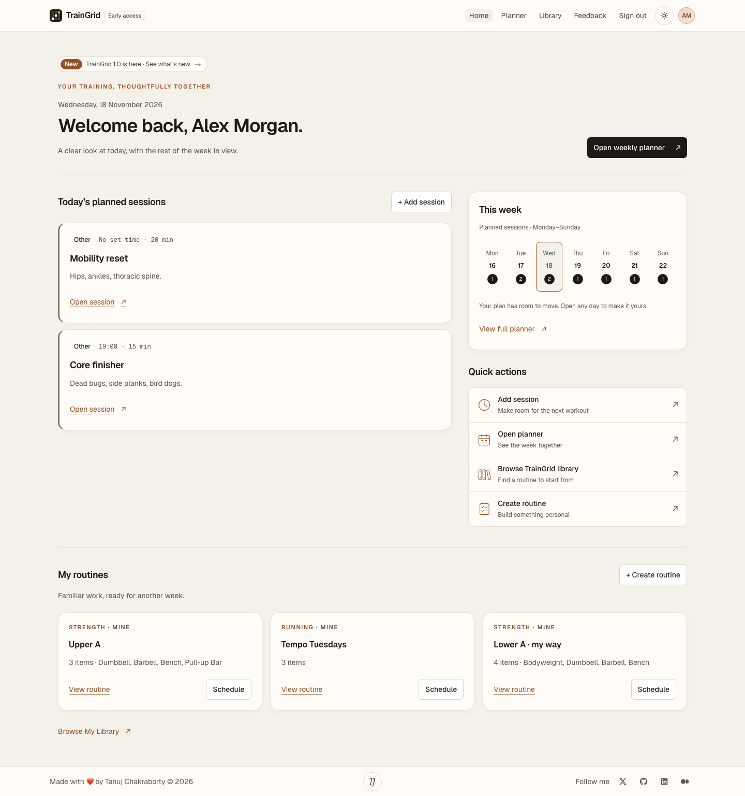
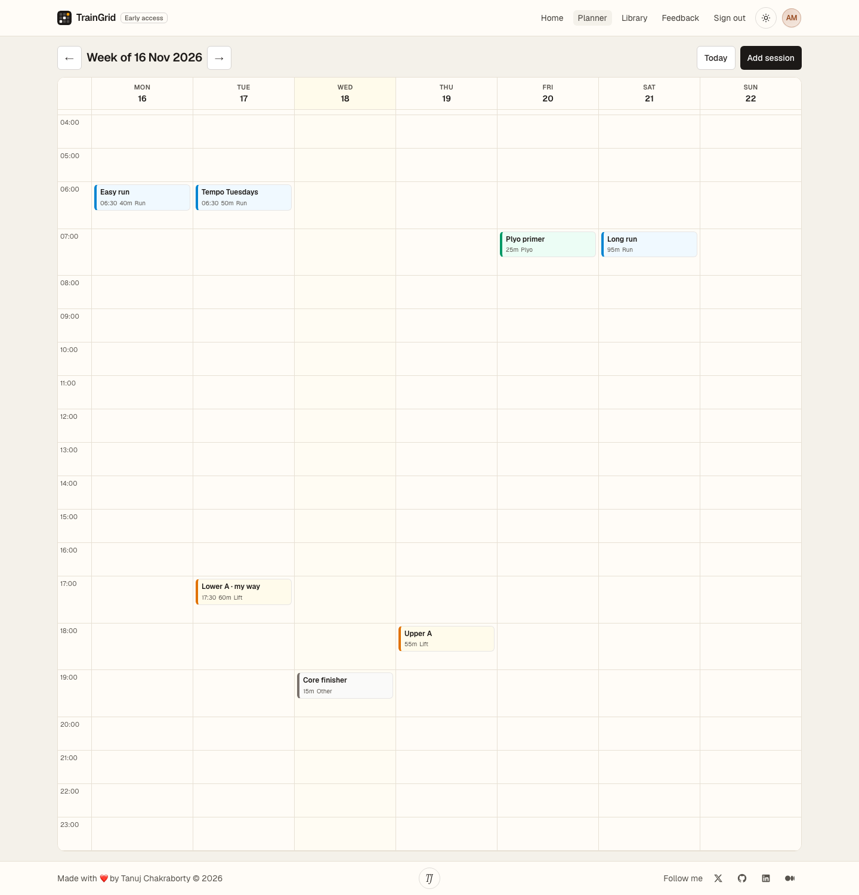
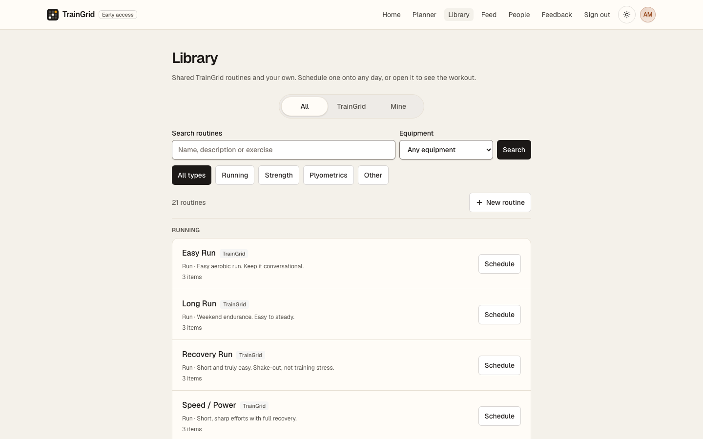
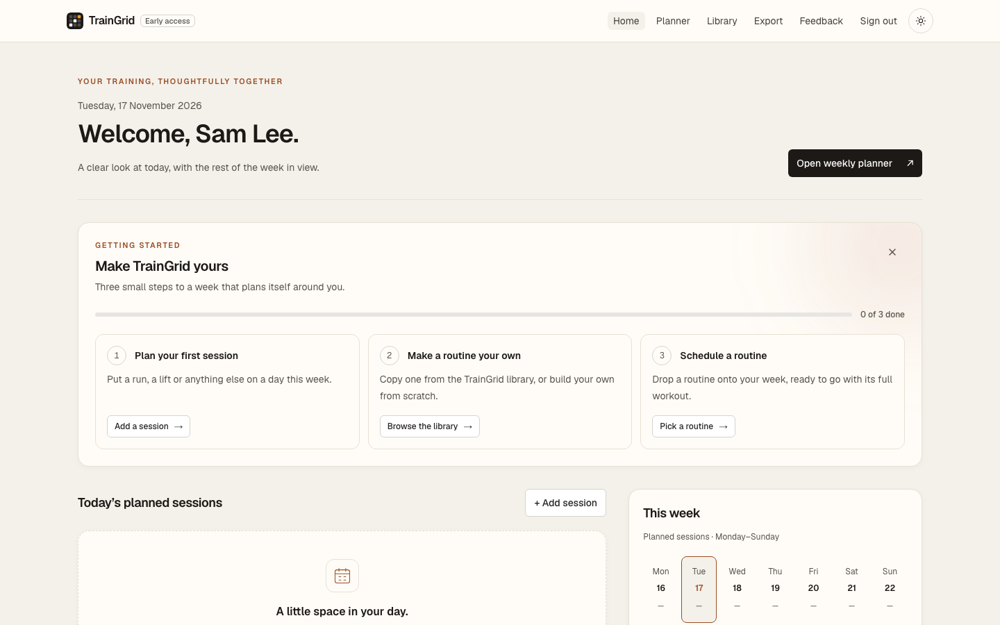
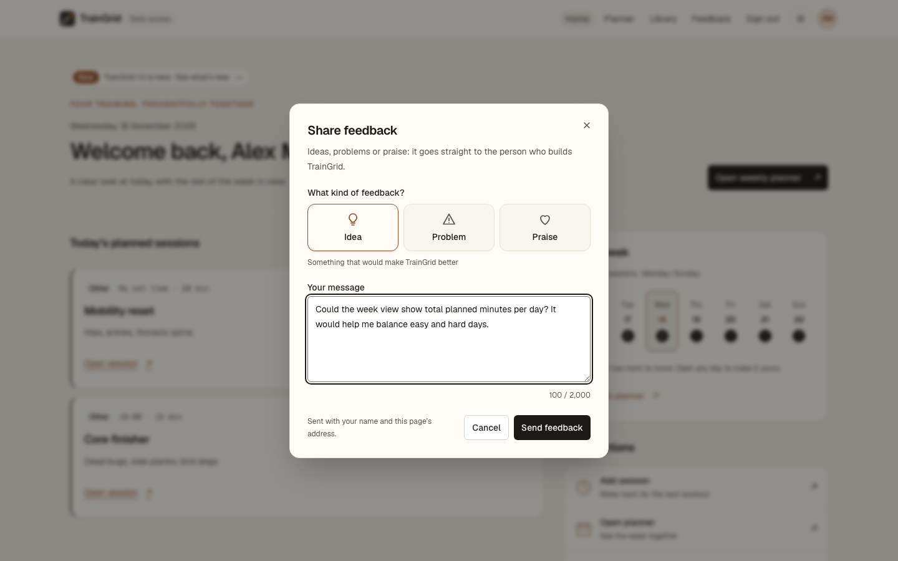
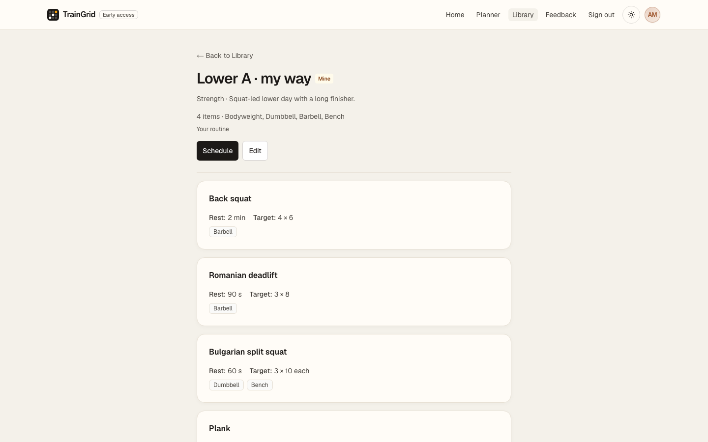
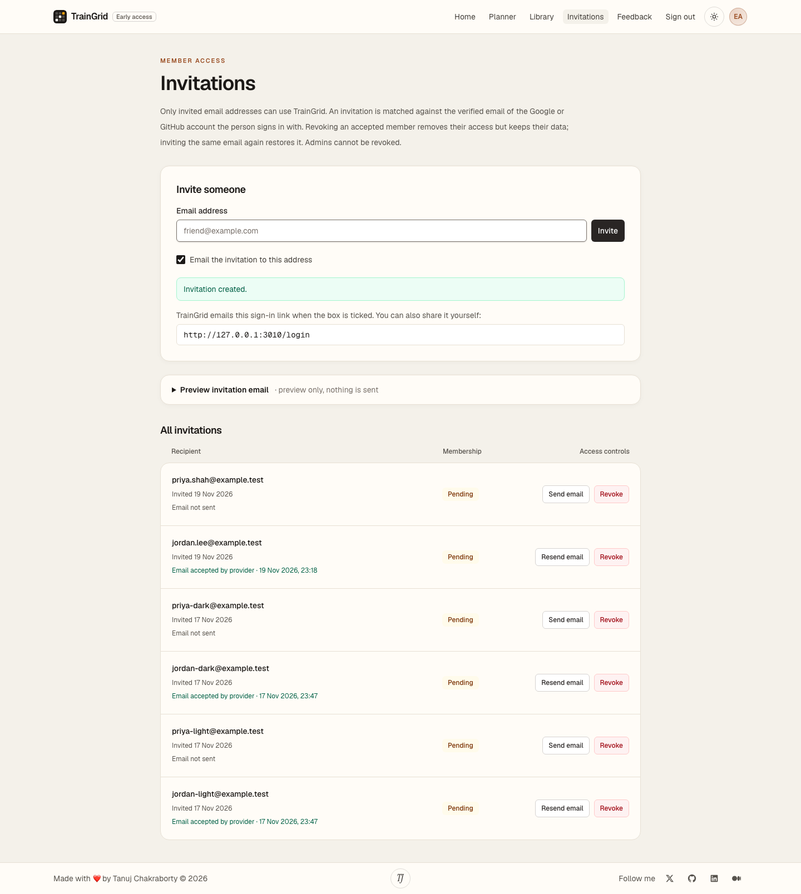
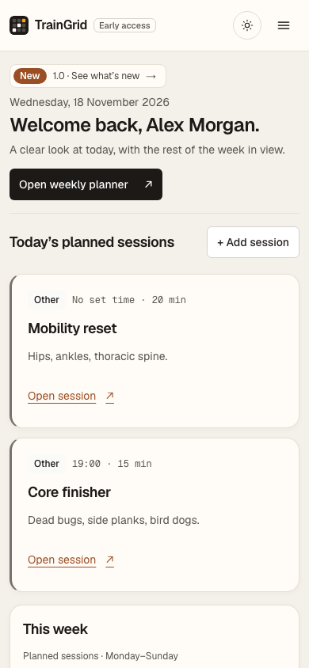
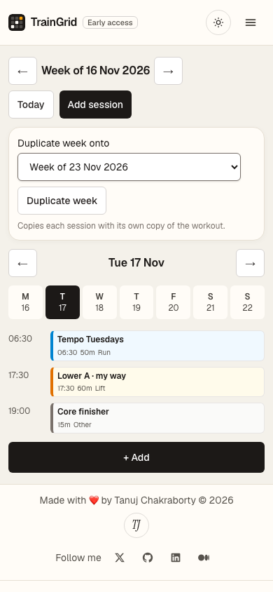
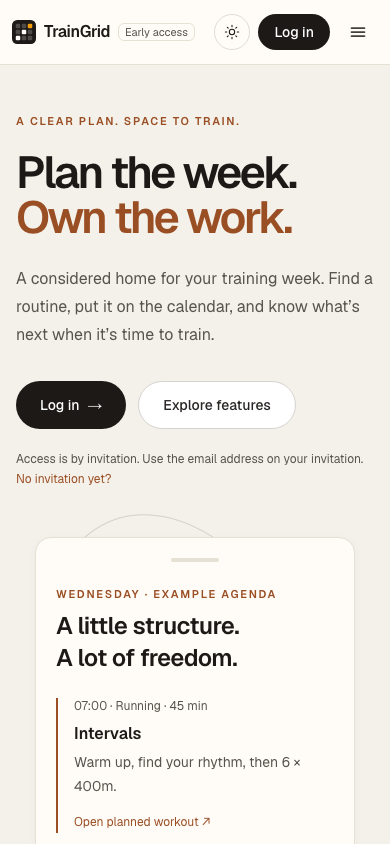

<p align="center">
  
</p>

<h1 align="center">TrainGrid</h1>

<p align="center"><strong>Plan the week. Own the work.</strong><br />
A calm, invite-only training planner: your week at a glance, a shared library of routines, and a straight answer to “what am I doing today?”</p>

<p align="center">
  <a href="https://github.com/i-am-tj/TrainGrid/releases"></a>
  <a href="https://github.com/i-am-tj/TrainGrid/actions/workflows/ci.yml"></a>
  
</p>

<p align="center">
  <picture>
    <source media="(prefers-color-scheme: dark)" srcset="docs/images/v1/home-desktop-dark.png" />
    
  </picture>
</p>

TrainGrid is **not** a workout logger. It plans training; keep Strava or Hevy for recording it.

---

## What’s new in 1.0

TrainGrid 1.0 is the first release for early-access members. Highlights:

- **A home that knows your day**: today’s sessions, the week’s planned counts and your routines, each loading on its own so the page is useful at once.
- **Getting started** for new members: three steps that tick themselves off as you plan, copy and schedule.
- **Feedback from anywhere**: ideas, problems or praise from the header, straight to the person who builds TrainGrid.
- **Install it** on your phone’s home screen, with its own icon and shortcuts.
- **Privacy notice, terms and What’s new**, readable before signing in.

Every release: [What’s new](https://github.com/i-am-tj/TrainGrid/blob/main/CHANGELOG.md) · [Releases](https://github.com/i-am-tj/TrainGrid/releases)

---

## A tour

<table>
  <tr>
    <td width="50%" valign="top">
      <picture>
        <source media="(prefers-color-scheme: dark)" srcset="docs/images/v1/planner-desktop-dark.png" />
        
      </picture>
      <p><strong>The week, together.</strong> Timed and untimed sessions, several per day, on a Monday–Sunday grid. Duplicate a week onto another in one step.</p>
    </td>
    <td width="50%" valign="top">
      <picture>
        <source media="(prefers-color-scheme: dark)" srcset="docs/images/v1/library-desktop-dark.png" />
        
      </picture>
      <p><strong>A library to start from.</strong> Shared TrainGrid routines and your own, searchable by name, exercise, type and equipment. Copy one to make it yours.</p>
    </td>
  </tr>
  <tr>
    <td width="50%" valign="top">
      <picture>
        <source media="(prefers-color-scheme: dark)" srcset="docs/images/v1/home-first-visit-desktop-dark.png" />
        
      </picture>
      <p><strong>A warm first visit.</strong> New members are welcomed by name and guided through three small steps.</p>
    </td>
    <td width="50%" valign="top">
      <picture>
        <source media="(prefers-color-scheme: dark)" srcset="docs/images/v1/feedback-desktop-dark.png" />
        
      </picture>
      <p><strong>Say what you think.</strong> A considered dialog for ideas, problems and praise, from any page.</p>
    </td>
  </tr>
  <tr>
    <td width="50%" valign="top">
      <picture>
        <source media="(prefers-color-scheme: dark)" srcset="docs/images/v1/routine-desktop-dark.png" />
        
      </picture>
      <p><strong>Routines with real detail.</strong> Sets, targets, rest, notes, equipment and demo links. Scheduling copies the routine, so your history never changes underneath you.</p>
    </td>
    <td width="50%" valign="top">
      <picture>
        <source media="(prefers-color-scheme: dark)" srcset="docs/images/v1/invitations-desktop-dark.png" />
        
      </picture>
      <p><strong>Invite-only, by design.</strong> Admins invite by email, see delivery status honestly, and revoke access while keeping the member’s data.</p>
    </td>
  </tr>
</table>

<p align="center">
  <picture>
    <source media="(prefers-color-scheme: dark)" srcset="docs/images/v1/home-phone-dark.png" />
    
  </picture>
  &nbsp;&nbsp;
  <picture>
    <source media="(prefers-color-scheme: dark)" srcset="docs/images/v1/planner-phone-dark.png" />
    
  </picture>
  &nbsp;&nbsp;
  <picture>
    <source media="(prefers-color-scheme: dark)" srcset="docs/images/v1/landing-phone-dark.png" />
    
  </picture>
</p>
<p align="center"><em>Made for phones too, in light and dark.</em></p>

---

## How it works

- **Invite-only.** Sign in with **Google** or **GitHub**. Only email addresses an admin has invited get in; there is no password and no public sign-up.
- **Your plan is yours.** Each member sees and edits only their own sessions and routines, enforced by the database (Row Level Security), not just the app.
- **A shared library.** TrainGrid routines (runs, lifts, plyometrics, warm-ups, cooldowns) are read-only for everyone. **Copy to My Library** makes an editable copy; the original never changes.
- **Scheduling copies.** Putting a routine on the calendar copies it into the session, so later edits never rewrite a planned or past session.
- **Today means your today.** “Today” follows your device’s time zone, on home and in the planner.

Guides: **[Member guide](docs/GUIDE.md)** · **[Admin guide](docs/ADMIN.md)** · all docs in **[docs/](docs/README.md)**

---

## How it runs

| Piece | Service |
| --- | --- |
| App | Next.js 16 on **Vercel**, deployed from `main` (region Sydney) |
| Database and sign-in | **Supabase**: PostgreSQL with Row Level Security, Supabase Auth (region Sydney) |
| Email | **Resend**, for invitations and feedback copies ([setup](docs/EMAIL_SETUP.md)) |
| Monitoring | Structured error logs, optional Slack/Discord alerts, `/api/health` for uptime ([security](docs/SECURITY.md#error-reports-and-alerts)) |
| Secrets | Vercel environment variables, never in Git |

Why and how: [ADR 001](docs/adr/001-multi-user-supabase-architecture.md) · setup: [docs/SUPABASE_SETUP.md](docs/SUPABASE_SETUP.md) · security: [docs/SECURITY.md](docs/SECURITY.md) · releases: [docs/RELEASING.md](docs/RELEASING.md)

---

## Run it locally

Needs **Node.js 22** and **Docker** (for the local Supabase stack). Local development never touches the production database.

```bash
git clone https://github.com/i-am-tj/TrainGrid.git
cd TrainGrid
npm install
npm run supabase:start      # local Postgres, Auth and API in Docker
npm run supabase:status     # prints the local URL and keys
cp .env.example .env.local  # then paste the local publishable key (and, for tests, the local secret key)
npm run dev
```

Open [http://localhost:3000](http://localhost:3000). Google and GitHub sign-in are configured only in production; locally, the test suites create throwaway users instead.

```bash
npm test                  # unit tests (Vitest)
npm run db:test           # database and Row Level Security tests (pgTAP)
npm run test:integration  # data layer against the local stack, as real users
npm run test:e2e          # browser tests (Playwright)
npm run test:all          # all of the above, plus lint, typecheck, build, UI and accessibility checks
npm run screenshots       # refresh the screenshots in docs/images/v1
npm run scan:secrets      # look for credentials in the repository
```

Every pull request runs lint, types, unit, database, integration and end-to-end tests in GitHub Actions ([docs/CI.md](docs/CI.md)).

```text
traingrid/
├── app/                  # routes: (marketing) landing, (app) member pages, (info) privacy/terms/what's new
├── components/
├── lib/
│   ├── data/             # every database read and write, validated with Zod
│   ├── auth/             # sign-in, sessions, route rules
│   ├── admin/            # invitations and their emails
│   ├── feedback/ onboarding/ observability/
│   └── email/            # Resend over fetch
├── supabase/
│   ├── migrations/       # schema, Row Level Security, functions
│   ├── tests/database/   # pgTAP tests
│   └── seed.sql          # the shared routines (generated)
├── data/templates/       # source Markdown for the shared routines
├── tests/                # integration and UI harness
├── e2e/                  # Playwright, plus docs.capture.ts for screenshots
├── docs/
└── agents/               # roadmap, backlog, decisions, story reports
```

---

## Say hello

Built by **Tanuj Chakraborty**.

If you have questions, suggestions, or need a hand, reach out anytime:

| | |
| --- | --- |
| **Email** | [tanuj.chakraborty21@gmail.com](mailto:tanuj.chakraborty21@gmail.com) |
| **GitHub** | [github.com/i-am-tj](https://github.com/i-am-tj) |
| **LinkedIn** | [linkedin.com/in/i-am-tj](https://www.linkedin.com/in/i-am-tj) |

Thanks for stopping by. Ciao ✨
