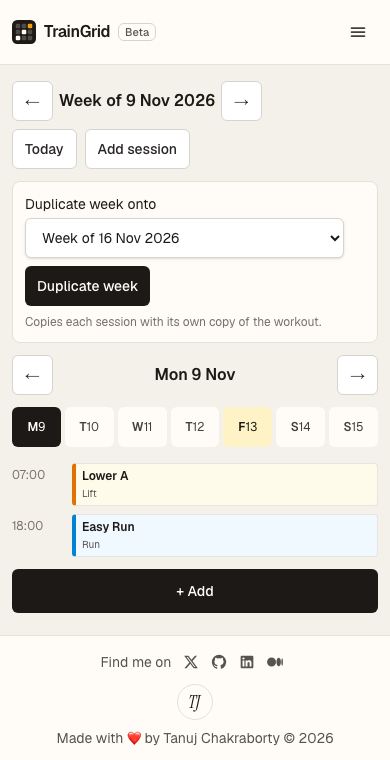
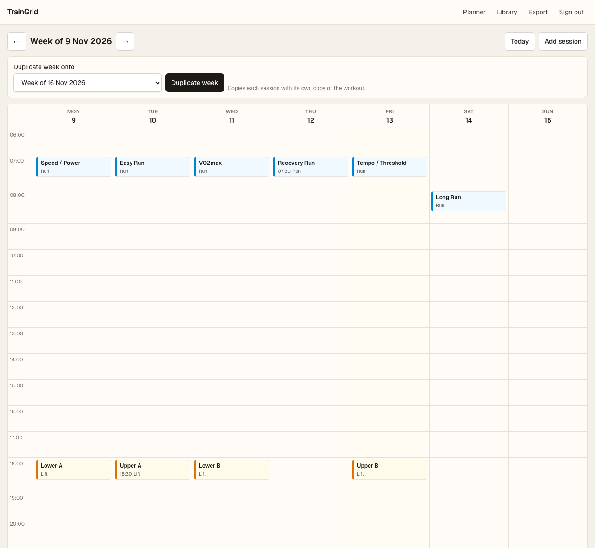
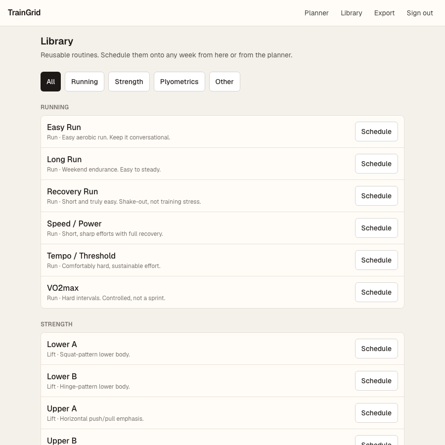
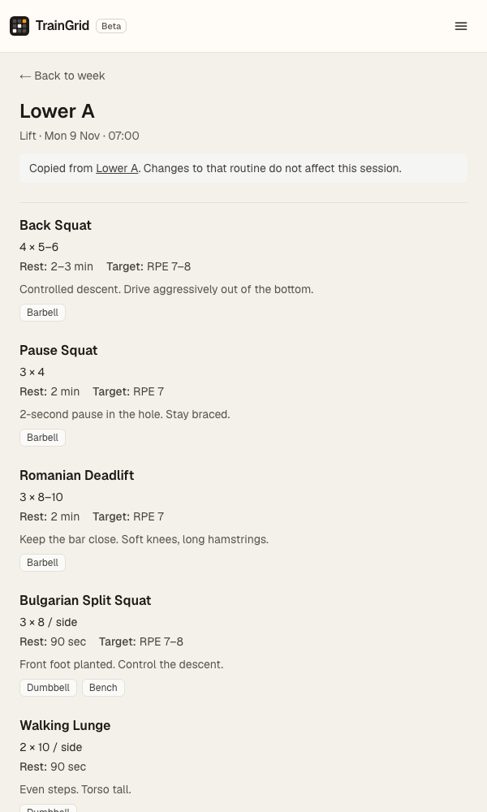

# TrainGrid

Plan the week. Show up. Don’t overthink it.

**TrainGrid** is a training planner for a small, invited group — a Monday–Sunday calendar, a shared library of running, strength and plyometrics routines, and a straight answer to “what am I doing today?”
It is **not** a workout logger. Keep Strava / Hevy for that.

<br />

<p align="center">
  
  &nbsp;&nbsp;&nbsp;
  
</p>

<p align="center"><em>Your week on a phone, and the full grid on a desktop.</em></p>

<p align="center">
  
  &nbsp;&nbsp;&nbsp;
  
</p>

<p align="center"><em>Pick a routine from the library, put it on the calendar, open it when it’s time.</em></p>

---

## How it works

- **Invite-only.** Sign in with **Google** or **GitHub**. Signing in proves who you are; only email addresses the admin has invited get in. Everyone else sees a polite “invite-only” note.
- **Your calendar is yours.** Each member sees and edits only their own sessions and routines — enforced by the database, not just the app.
- **A shared library.** The TrainGrid routines (runs, lifts, plyometrics, warm-ups, cooldowns) are read-only for everyone. Browse them in **All**, **TrainGrid** or **Mine**, search by name, description or exercise, and filter by type and equipment. Like one? **Copy it to My Library** and make it yours, or create your own from scratch.
- **Scheduling copies.** Putting a routine on the calendar copies it into the session, so later changes to the routine never rewrite a past or planned session. Tweak one session without touching the routine.

---

## What’s in the box

- **7-day planner** with timed and untimed sessions, several per day, and a mobile day view
- **Routines** with structured workout items: instruction, rest, target, notes, **equipment** tags and **YouTube** demo links
- **Library search and filters** (shareable URLs), item count and equipment at a glance, and **Schedule** straight from a card or a routine
- **Copy to My Library**: an editable copy of any TrainGrid routine, leaving the original untouched
- **Duplicate a week** onto another week
- **Export** your own routines and sessions as JSON
- **Admin page** to invite people, see who joined, and revoke access (their data is kept)

More detail: [docs/](docs/README.md). Maintaining the shared routines: [docs/CONTENT.md](docs/CONTENT.md). What changed in each release: [CHANGELOG.md](CHANGELOG.md) and [Releases](https://github.com/i-am-tj/TrainGrid/releases).

### Sign-in providers

| Provider | Status |
| --- | --- |
| Google | Supported |
| GitHub | Supported |
| Apple | Deferred — needs a paid Apple Developer membership, and TrainGrid runs at zero cost |
| ChatGPT | Deferred — waiting for practical, general developer availability |

There is no email/password sign-in and no public sign-up.

---

## How it runs

| Piece | Service |
| --- | --- |
| App | Next.js 16 on **Vercel** (Hobby), deployed from GitHub |
| Database and sign-in | **Supabase** (Free): PostgreSQL with Row Level Security, Supabase Auth |
| Secrets | Vercel environment variables — never in Git |

Why and how: [ADR 001](docs/adr/001-multi-user-supabase-architecture.md) · setup: [docs/SUPABASE_SETUP.md](docs/SUPABASE_SETUP.md) · security: [docs/SECURITY.md](docs/SECURITY.md)

---

## Run it locally

Needs **Node.js 20+** and **Docker** (for the local Supabase stack). Local development never touches the production database.

```bash
git clone https://github.com/i-am-tj/TrainGrid.git
cd TrainGrid
npm install
npm run supabase:start      # local Postgres, Auth and API in Docker
npm run supabase:status     # prints the local URL and keys
cp .env.example .env.local  # then paste the local publishable key (and, for tests, the local secret key)
npm run dev
```

Open [http://localhost:3000](http://localhost:3000). Google and GitHub sign-in are configured only on production; locally, the test suites create throwaway users instead.

```bash
npm test                  # unit tests (Vitest)
npm run db:test           # database and Row Level Security tests (pgTAP)
npm run test:integration  # data layer against the local stack, as real users
npm run test:e2e          # browser tests (Playwright)
npm run test:all          # all of the above, plus lint, typecheck and build
npm run scan:secrets      # look for credentials in the repository
```

```text
traingrid/
├── app/                  # Next.js routes (planner, sessions, library, admin, auth)
├── components/
├── lib/
│   ├── data/             # every database read and write, validated with Zod
│   ├── auth/             # sign-in, sessions, route rules
│   └── admin/            # invitation management
├── supabase/
│   ├── migrations/       # schema, Row Level Security, functions
│   ├── tests/database/   # pgTAP tests
│   └── seed.sql          # the shared routines (generated)
├── data/templates/       # source Markdown for the shared routines (+ seed-ids.json, the id lock)
├── tests/integration/
├── e2e/
├── docs/
└── agents/               # roadmap, backlog, decisions, test plan, story reports
```

---

## Say hello

Built by **Tanuj Chakraborty**.

If you have questions, suggestions, or need a hand — reach out anytime:

| | |
| --- | --- |
| **Email** | [tanuj.chakraborty21@gmail.com](mailto:tanuj.chakraborty21@gmail.com) |
| **GitHub** | [github.com/i-am-tj](https://github.com/i-am-tj) |
| **LinkedIn** | [linkedin.com/in/i-am-tj](https://www.linkedin.com/in/i-am-tj) |

Thanks for stopping by — ciao ✨
