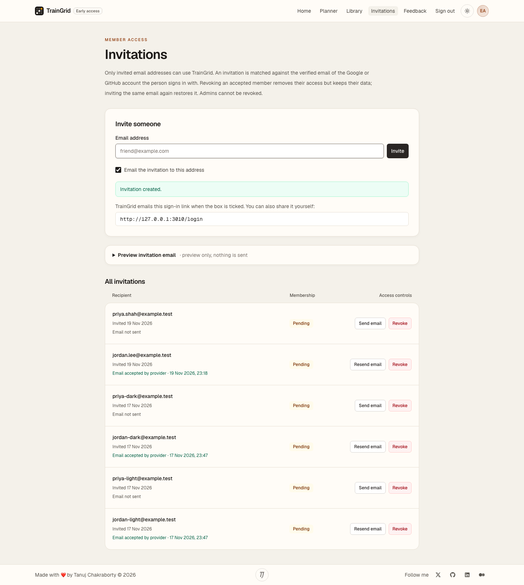

# TrainGrid admin guide

For the owner and any admin. Members don’t see any of this. Admins are the Supabase user ids
listed in `TRAINGRID_ADMIN_USER_IDS` (Vercel → Settings → Environment Variables).

  <picture>
    <source media="(prefers-color-scheme: dark)" srcset="images/v1/invitations-desktop-dark.png" />
    
  </picture>

## Invite someone

1. **Invitations** in the header → enter their email → leave **Email the invitation to this
   address** ticked → **Invite**.
2. They sign in with the Google or GitHub account whose **verified** email matches. Their first
   sign-in accepts the invitation and creates their membership.
3. Prefer to send it yourself? Untick the box and share the sign-in link shown on the page.

### What the email status means

| Status | Meaning |
| --- | --- |
| Email not sent | No send was requested. Use **Send email**, or share the link yourself. |
| Email sending… | A send is in progress; a second one is refused. |
| Email accepted by provider · time | Resend accepted it. This is **not** proof it reached the inbox. |
| Email failed · time · invitation still valid | The send failed; the invitation is untouched. Retry. |

Sends are limited by the database: one at a time per invitation, none within a minute of an
accepted one, at most five per invitation per 24 hours. Email setup: [EMAIL_SETUP.md](EMAIL_SETUP.md).

## Revoke access

**Revoke** on a pending invitation withdraws it. **Revoke access** on a member signs them out of
TrainGrid at their next request and hides everything; **their data is kept**, and inviting the same
email again restores it. Admins can’t be revoked from the page. Every revoke asks for confirmation
in a dialog first.

To delete a member and all their data for good (for example, on request): first **Revoke access**
here, so their email can’t sign in again, then delete the user in Supabase → Authentication →
Users. Their profile, routines, sessions and feedback are removed with them; the revoked invitation
stays as a record that the address was once invited.

## Review invite requests

Visitors without an invitation can ask for one: **Request an invite** on the sign-in page (the
landing page's "No invitation yet?" links open it too). They give an email address and, if they
like, a name and a short note.

- Each new request is emailed to `TRAINGRID_INVITE_REQUESTS_TO` (or, if unset,
  `TRAINGRID_FEEDBACK_TO`) from **TrainGrid Requests**, with a link to the Invitations page.
  Reply to the email to answer the person directly.
- On **Invitations → Requests**, oldest first: **Invite and email** creates the invitation and
  sends it (just **Invite** when email is not set up); **Dismiss** declines quietly. Nothing is
  sent to the person when you dismiss. Inviting the same address from the form above also clears
  its request.
- Once invited, they come back to `/login` and continue with the Google or GitHub account that
  uses that address.
- Limits: one pending request per address, three per network per hour, 50 a day in total (then
  requests pause until the next day). The visitor is never told whether an address is already
  invited. Requests are deleted after 180 days.

## Read feedback

Members’ feedback is stored in the `member_feedback` table: Supabase → Table Editor →
`member_feedback` (newest first by `created_at`). Each row has the kind, the message, the page and
the member’s user id. Nobody can read it through the app.

To also get each message by email, set `TRAINGRID_FEEDBACK_TO` (needs the email settings). The
email’s Reply-To is the member, so you can answer directly.

## Know when something breaks

- **Uptime**: point a monitor (for example UptimeRobot, free) at `https://<your-domain>/api/health`.
  It answers `200` when the app can reach Supabase and `503` when it can’t.
- **Errors**: every server error appears in Vercel → Logs as `"event":"server_error"`, without any
  member data. Set `TRAINGRID_ALERT_WEBHOOK_URL` to a Slack or Discord incoming webhook to be
  alerted, at most once per distinct error per 10 minutes. Details: [SECURITY.md](SECURITY.md#error-reports-and-alerts).

## Contact details on the legal pages

`/privacy` and `/terms` show `TRAINGRID_CONTACT_EMAIL` as the contact address. Without it, they
point members to the Feedback button. These pages describe what TrainGrid does today; have them
reviewed if you need legal certainty for your situation, and update them when what is stored or
who processes it changes.

## Releases

How versions and releases work, and the production checklist for each one: [RELEASING.md](RELEASING.md).
