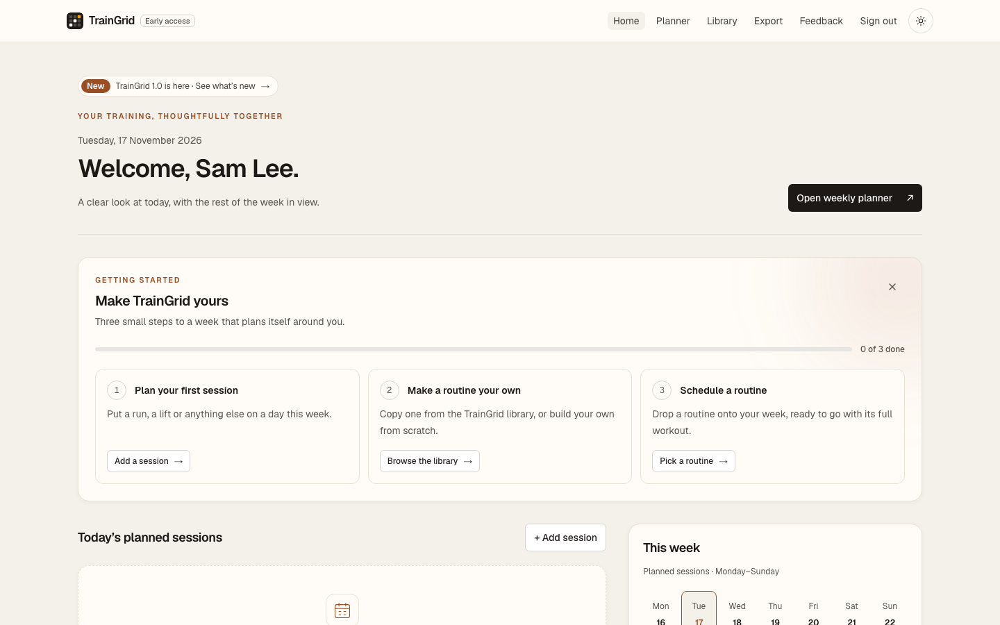
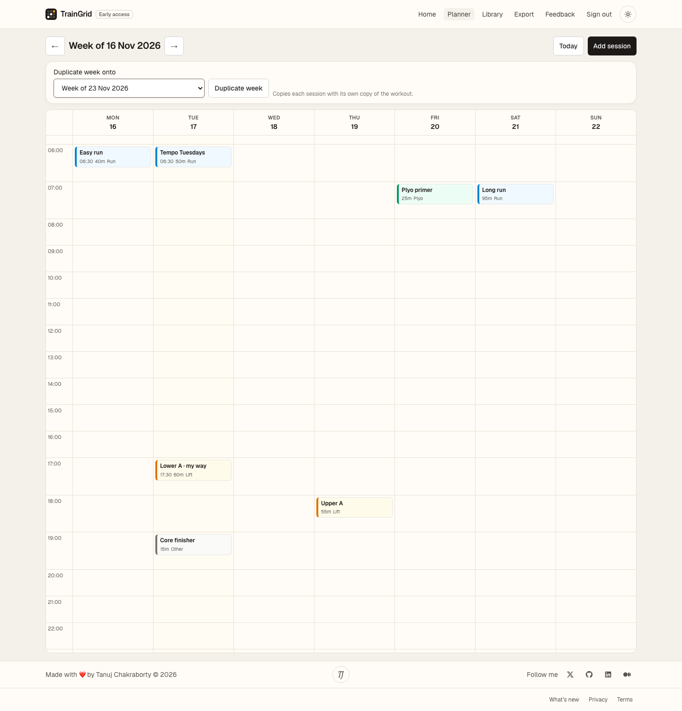

# TrainGrid member guide

Welcome to TrainGrid. This guide takes about five minutes and covers everything you need to plan
your training week. Something unclear or missing? Use **Feedback** in the header; it reaches the
person who builds TrainGrid.

  <picture>
    <source media="(prefers-color-scheme: dark)" srcset="images/v1/home-first-visit-desktop-dark.png" />
    
  </picture>

## 1. Sign in

1. Open TrainGrid and choose **Log in**.
2. Continue with **Google** or **GitHub**, using the account whose email address your invitation
   was sent to. There is no TrainGrid password.
3. On your first visit, home greets you with **Welcome**; from then on, **Welcome back**.

If you see an "invite-only" note, the email you signed in with does not match your invitation.
Sign out and try the other account, or ask whoever invited you to check the address.

## 2. Home: today at a glance

Home shows the day ahead and the week around it:

- **Today’s planned sessions**, untimed first, then by start time. Open one to see its full workout.
- **This week**: how many sessions are planned on each day. Tap a day to open it in the planner.
- **Quick actions** for the things you do most.
- **My routines**: your three most recently changed routines, ready to schedule.

New here? The **Getting started** card has three steps (plan a session, make a routine your own,
schedule a routine). Each ticks itself off when you do it, and the card steps aside when you’re
done. You can also hide it with **×**.

## 3. Plan your week

  <picture>
    <source media="(prefers-color-scheme: dark)" srcset="images/v1/planner-desktop-dark.png" />
    
  </picture>

- **Planner** shows Monday to Sunday. On a phone it shows one day at a time; move between the
  days with the arrow buttons.
- **Add session** puts a run, a lift or anything else on a day, with or without a time. Several
  sessions per day are fine.
- Open a session to **edit**, **reschedule** or **delete** it, or to **customise** its workout for
  that day only.
- **Duplicate week** copies every session of this week onto another week, as fresh copies.

## 4. Routines and the library

- **Library** has three views: **All**, **TrainGrid** (the shared routines) and **Mine** (yours).
- **Search** by name, description or exercise, and filter by type and equipment. Every search is a
  link you can bookmark.
- **Copy to My Library** makes an editable copy of a TrainGrid routine. The original never changes.
- **Create routine** builds your own, with workout items: instruction, sets or target, rest, notes,
  equipment and an optional YouTube demo link.
- **Schedule** puts a routine on a day. TrainGrid copies the workout into the session, so editing
  the routine later never changes sessions you have already planned or done.

## 5. TrainGrid on your phone

TrainGrid installs like an app:

- **iPhone (Safari)**: Share → **Add to Home Screen**.
- **Android (Chrome)**: menu ⋮ → **Install app** (or **Add to Home screen**).

It opens on your home page in its own window, with shortcuts to the planner and the library when
you long-press the icon.

## 6. Feedback

**Feedback** in the header opens a short form: choose **Idea**, **Problem** or **Praise**, write a
few words, and send. It includes your name and the page you were on, nothing else. Every note is
read.

## 7. Your data

- Your plan is private: other members can never see it.
- **Export** in the header downloads all your routines and sessions as a JSON file, any time.
- To have your account and data deleted, ask through **Feedback**.

Read the full [privacy notice](https://train-grid.vercel.app/privacy) and
[terms](https://train-grid.vercel.app/terms). See what changed in each release on
[What’s new](https://train-grid.vercel.app/whats-new).

## Light and dark

The sun and moon button in the header switches between light and dark. Until you choose,
TrainGrid follows your device.
