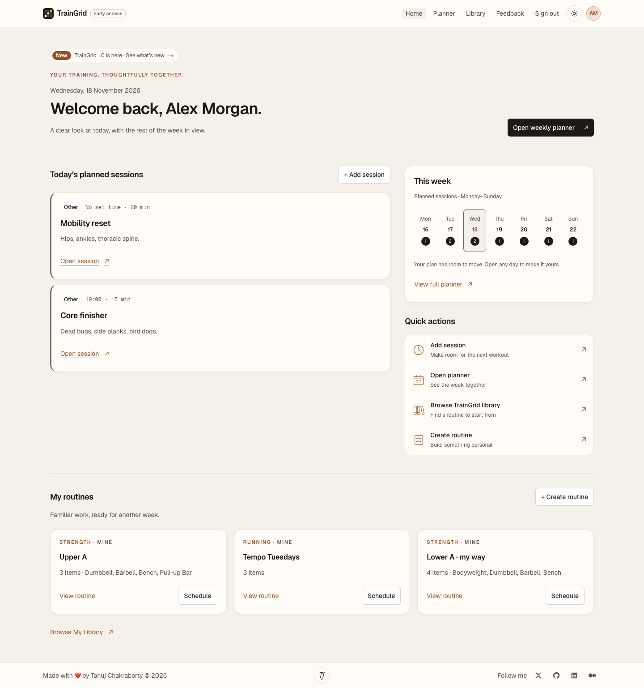

# TrainGrid docs

  <picture>
    <source media="(prefers-color-scheme: dark)" srcset="images/v1/home-desktop-dark.png" />
    
  </picture>

## Start here

| Doc | For | What’s in it |
| --- | --- | --- |
| [GUIDE.md](./GUIDE.md) | Members | Signing in, home, planning the week, routines, installing on a phone, feedback, your data. Send this to new members. |
| [ADMIN.md](./ADMIN.md) | Admins | Inviting, email status, revoking, deleting a member, reading feedback, monitoring. |
| [../CHANGELOG.md](../CHANGELOG.md) | Everyone | Every release; also in the app at `/whats-new`. |

## Running TrainGrid

| Doc | What’s in it |
| --- | --- |
| [SUPABASE_SETUP.md](./SUPABASE_SETUP.md) | Local Supabase stack, the production project, every environment variable |
| [EMAIL_SETUP.md](./EMAIL_SETUP.md) | Resend and DNS (Namecheap) for invitation and feedback email |
| [SECURITY.md](./SECURITY.md) | Credentials, dev/prod separation, error reports and alerts, feedback storage, release checks |
| [RELEASING.md](./RELEASING.md) | Versions and how a release is made |
| [CI.md](./CI.md) | What runs on every pull request, and how to reproduce it locally |
| [CONTENT.md](./CONTENT.md) | Maintaining the shared TrainGrid routines |

## How it is built

| Doc | What’s in it |
| --- | --- |
| [TECHNICAL_DESIGN.md](./TECHNICAL_DESIGN.md) | Architecture, security model, data model, routing |
| [DATA_FORMAT.md](./DATA_FORMAT.md) | Database tables, snapshot and export formats, seed templates |
| [TEST_PLAN.md](./TEST_PLAN.md) | Test strategy and coverage |
| [BRANDING.md](./BRANDING.md) | Logo files and where they are used |
| [adr/](./adr/) | Architecture decision records |
| [../agents/ROADMAP.md](../agents/ROADMAP.md) | Releases, current features and what may come next |
| [../agents/DECISIONS.md](../agents/DECISIONS.md) | The product and engineering decisions in force |

## Screenshots

`images/social/` holds the social screens (feed, profiles, people, requests, composer, settings),
captured the same way by `e2e/social.capture.ts`.

`images/v1/` holds the current screenshots, in light and dark, desktop and phone. They are made
from the app itself, never by hand: `npm run screenshots` seeds a believable member on the local
stack and captures every screen from a production build (`e2e/docs.capture.ts`). Older,
epic-by-epic captures live in `images/epic-3/` with their archived reports
(`agents/archive/`).

Historical records: [archive/](./archive/).
