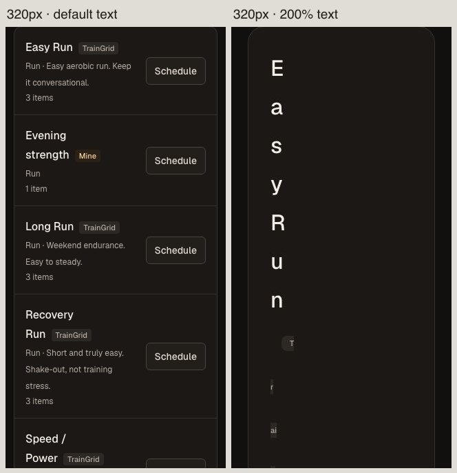

# TrainGrid UI design audit

**25 November 2026 · Review only · Overall design score 7/10**

Keep the visual identity and the workout player. The most consequential problems appear when someone tries to **find their work**. At 320 CSS pixels with text doubled, the Library reduced the first routine’s description column to 9 pixels. At ordinary desktop size, the planner opened with an existing untimed workout above the visible calendar. Both failures are easy to miss on a polished screenshot of a typical week.

Give the next design cycle three outcomes. A member can read every routine at their preferred text size, can find every planned session with pointer or keyboard, and can see exactly what a post will share before publishing. A brand refresh would do little for any of these.

## Scorecard

Scores are expert judgments. A 9 indicates strong performance across the exercised states, a 7 indicates usable flows with specific friction, and a 5 indicates a substantial barrier under a tested condition. The overall score reflects the importance of planning and training. It is not a compliance score.

| Category | /10 | Basis |
|---|---:|---|
| Visual identity and typography | 8 | Warm surfaces, restrained copper, readable headings and recognizable session accents work in both themes. Small metadata and repeated introductory labels compete with the substance on several screens. |
| Component consistency | 7 | Forms, cards, dialogs and selected states feel related. Identical-looking start actions do different things, and two vocabularies describe the same workout types. |
| Navigation and discoverability | 6 | Home, Planner and Library have distinct jobs. The desktop grid conceals untimed work, several pages share a browser title, and a missing routine sends the member to Planner. |
| Responsive layout and text enlargement | 5 | The phone agenda is well adapted. The enlarged Library becomes impractical to browse and the visibility chooser exceeds the viewport. The tablet header consumes up to three rows. |
| Core task journeys | 8 | First visit → scheduled routine and planned workout → recorded completion both worked. Scheduling a routine already chosen in the Library asks the member to reconsider several defaults. |
| Interaction and recovery | 7 | Inline invite validation, focus restoration and the workout’s saved state are strengths. Error routing and the placement of the social preview need attention. |
| Accessibility | 6 | Skip navigation and several keyboard dialogs worked. Grid traversal, page titles and enlarged text remain barriers. Automated scans also left checks for human review. |
| Perceived performance | 8 | Login recorded zero layout shift locally. A delayed navigation gave feedback and recovered. The full-page dimmer hides useful context on a routine lookup. |

## Review conditions and evidence

The reviewed main revision was `57cc63d`. The running production build came from `5410511`. The complete intervening diff comprised the CI workflow, CI documentation, the health API and its test. The rendered UI, styles, UI tests, dependencies and schema were identical. All interactions used a disposable local Supabase project and invented identities. UTC was selected for the scheduling fixtures, so their date can differ from the review date.

- **Visual and mobile testing.** Captured 32 screens or states at 1366×900 light and 390×844 dark. Repeated ten representative screens at 320×640, 768×1024, 844×390, 320×640 with 200% root text, 1366×900 dark and 390×844 light. This gives 124 baseline observations plus the interaction captures below. The paired images are viewport captures. Select a link to inspect at full resolution. Same-size theme controls show that the Home action hierarchy persists across palettes. [Desktop dark](images/ui-design-audit/home-wideDark.jpg) · [Phone light](images/ui-design-audit/home-phoneLight.jpg) · [Baseline comparison](images/ui-design-audit/home.jpg)
- **Agentic browser and exploratory testing.** Navigated as visitor, first-time member, returning member, follower and admin. Submitted an invalid then valid invite request, found it in the admin queue, scheduled Easy Run for tomorrow at 06:30 and reopened it from Planner. Logged three sets, skipped rest, reloaded mid-workout, finished and saw the completed state on Home. Wrote a private-audience post and found the caption in Feed. Approved a request and found the member under Followers. Opened Feedback, cancelled a routine deletion and checked focus restoration. These are observed outcomes from synthetic personas. No participant study was conducted.
- **Accessibility testing.** Ran `npm run test:audit` against the optimized build. All 8 Chromium tests passed in 27 seconds. The 42 saved axe results contained zero reported violations and each contained an incomplete check. Across those reports the outstanding rules were contrast and links within text. Six further dark phone scans covered the landing route, Home, Feed, People, social settings and the completed workout. They reported zero violations and five left incomplete checks. Manually exercised Tab, Enter, Escape, the skip link, menu, dialogs and calendar focus. The suite’s 320×256 login check simulates the CSS viewport at 400% zoom. The separate 200% root-font experiment stresses text reflow. Neither substitutes for assistive-technology testing.
- **Engines and performance.** Chromium covered the full review. Playwright Firefox and WebKit each opened Login and the invite dialog. The optimized login measurement recorded CLS 0, 193,609 encoded script bytes and zero external resource origins in that run. A deliberately delayed 1.7-second local routine navigation displayed “Loading page…” and cleared on arrival. Reduced-motion styling was active during the survey. Field Web Vitals, physical devices, OS magnification, VoiceOver/TalkBack/NVDA, real OAuth, email delivery and response to prolonged outages remain unverified. [Loader](images/ui-design-audit/loader.jpg) · [Accessibility and performance suite](../e2e/ui-04.audit.ts)
- **Skill selection.** Applied `visual-testing` for comparable captures and state review, `mobile-testing` for viewport, orientation and target checks, `accessibility-testing` for axe plus keyboard and reflow, `agentic-browser-testing` for goal-led navigation and `exploratory-testing` for first-use, interruption and recovery charters. Mobile coverage used the device-independent web UI. Screenshots document the observed build rather than establishing future pixel-diff tolerances.

## Ten highest-impact improvements

P0 means an immediate product-wide blocker. None was observed. P1 means a core journey or accessible mode is materially impaired. P2 means recurring friction, and P3 means polish or an opportunity to validate. Estimates cover implementation and a focused regression check by one engineer. S is up to one day, M is roughly two to four days. **Observed** describes a reproduced state or measured interaction. **Judgment** describes its interpretation or a proposed design choice. Expected benefits are predictions.

| Rank | Location and evidence | Decision and expected user benefit | Priority / effort |
|---:|---|---|---|
| 1 | **Library routine rows, observed.** At 320px the first text link was 163px wide and its row 128px tall. At 200% text it became 9px wide inside a 2,886px row. “Easy Run” ran down the screen one character at a time. The page still passed a horizontal-overflow check. [Row at 200%](images/ui-design-audit/library-row-large.jpg) | **Redesign row reflow.** Give the description a readable minimum line length and move Schedule below it when space is insufficient. Schedule must remain a separate, named action. Check actual word wrapping as well as document width. | P1 / S |
| 2 | **Desktop Planner, observed.** Home showed Evening strength and Lunch run. The week opened at 06:00 showing only Lunch run. The untimed link’s top was −182px, the grid started at 129px and its internal scroll offset was 388px. Scrolling the grid to the top revealed the saved workout. [Initial week and phone agenda](images/ui-design-audit/planner.jpg) · [After scrolling up](images/ui-design-audit/untimed.jpg) | **Redesign the untimed row.** Keep populated untimed sessions visible against their day above the scrolling hours. Retain the useful 06:00 starting position and the compact phone agenda. A member can reconcile Home and Planner at a glance. | P1 / M |
| 3 | **Desktop Planner keyboard path, observed.** The focusable time region contained 177 links on the two-session week. Of those, 168 were hourly add links and seven were untimed add links. After focusing the region, Tab moved through the untimed row before the hours. [Keyboard focus](images/ui-design-audit/keyboard-grid.jpg) | **Redesign traversal.** Keep scheduled sessions and the main Add session action reachable efficiently. Offer an explicit slot-selection mode with day/hour navigation and an obvious exit. Preserve direct pointer scheduling. Verify that a keyboard user can reach the last session and leave the calendar without traversing empty hours. | P1 / M |
| 4 | **Social visibility, admin warning and Home at enlarged text, observed.** At 320px their document widths reached 357px, 443px and 323px respectively. The offenders were the visibility fieldset, the unbroken configuration key and Start a workout. [Visibility choices](images/ui-design-audit/visibility-large.jpg) | **Improve reflow.** Allow the fieldset and legend to shrink, wrap long admin identifiers and let the Home action wrap. Assert the width and legibility of the actual controls. Members can compare privacy choices without horizontal panning. | P1 / S |
| 5 | **Social publishing, observed ordering and design judgment.** On a 390px phone Post update began at y=620, Preview at y=686, and the session snapshot and audience explanation continued below the fold. The instructions explicitly ask the author to review it. Edit has the same action order. [Typed caption and preview](images/ui-design-audit/compose-review.jpg) | **Relocate the final action** after the preview in mobile visual and keyboard order. Place a concise audience label beside it. Retain the live two-column desktop preview. Authors can verify audience and contents before committing. | P2 / S |
| 6 | **Returning and first-use Home, observed labels and design judgment.** On phone “Start a workout” at y=213 starts a new unscheduled workout. “Start workout” at y=480 opened the existing Evening strength plan. The newcomer’s suggested “Choose a routine” was at y=540. [Home](images/ui-design-audit/home.jpg) · [Quick-start choices](images/ui-design-audit/quick-start.jpg) | **Improve hierarchy.** Label the global action “Start an unplanned workout.” Prioritize the scheduled session when one exists and the first routine when the week is empty. Keep unplanned training one action away. | P2 / S |
| 7 | **Library → Schedule, observed.** After choosing Easy Run, the add form still presented Routine/Blank, a routine selector, editable name and notes. On the sampled phone the Add button started at y=939. Tomorrow and 06:30 worked, and the calendar kept the intended routine. [Scheduling form](images/ui-design-audit/add.jpg) | **Simplify the known-routine path.** Lead with the selected routine, date, time or Untimed, then “Schedule routine.” Put rename, notes, duration and change-routine behind an edit affordance. Keep the full editor for a blank session. | P2 / M |
| 8 | **Route identification, observed.** Nine sampled screens had the browser title “TrainGrid,” including the week, all three routine views, session detail and both session editors. The on-page headings differed. [Planner](images/ui-design-audit/planner.jpg) · [Session editor](images/ui-design-audit/editsession.jpg) | **Improve titles.** Supply task-specific titles such as “Edit session · TrainGrid” and “Weekly planner · TrainGrid.” Avoid putting private notes in browser history. Check tab titles and route announcements with an actual screen reader. | P2 / S |
| 9 | **Missing Library item, observed.** Opening a nonexistent routine gave “Session or page not found” with only “Back to planner.” In a fresh dark-preference page load the error rendered light. The same context rendered Library dark. [Error in both requested schemes](images/ui-design-audit/missing.jpg) | **Improve recovery.** Offer “Back to Library” on this route, use neutral wording when the cause is unknown, and initialize the chosen theme on direct error loads. Members retain their place without disclosing whether another member owns an item. | P2 / S |
| 10 | **Session detail, observed wording and design judgment.** Adjacent controls “Edit” and “Customize content” open different editors. One changes date, time, name and notes. The other changes exercises. The distinction appears after navigation. [Session detail](images/ui-design-audit/session.jpg) | **Rename the destinations** to “Edit schedule & details” and “Edit exercises.” Carry those labels into the headings. Members can choose the right task on the first tap and keep the safe session-only editing boundary. | P2 / S |

## Page-by-page review

Each evidence link opens the screen as observed. The paired images show desktop light on the left and phone dark preference on the right. The missing-item image records the theme defect. The source column names the responsible component or route relative to the repository. Recommendations without a measured failure are design judgments.

### Public site, access and onboarding

| Screen / evidence | Keep | Finding, decision and user benefit | Source |
|---|---|---|---|
| [Landing](images/ui-design-audit/landing.jpg) | The headline explains the product, and its example visibly changes from a week on desktop to an agenda on phone. Login and request access are available near the top. | The 390px page measured 7,289px tall. “Explore features” and the hero already cover the proposition. Defer shortening until testing which later sections help a visitor decide. If compressing, preserve the example and invitation path first. | `components/marketing/LandingPage.tsx` |
| [Login](images/ui-design-audit/login.jpg) · [Denied access](images/ui-design-audit/login-error.jpg) | Equal-size provider buttons, clear explanation of the invited address, an actionable mismatch message and a visible invitation alternative. | The header wordmark and Early access badge repeat inside the login card. Remove the second brand row on phone and bring the invited-email rule closer to the provider choice. This spends scarce height on a prerequisite. | `app/(app)/login/page.tsx` |
| [Invite validation](images/ui-design-audit/invite-error.jpg) · [Confirmation](images/ui-design-audit/invite-success.jpg) | Invalid email kept the form open. Success named the entered address, described review and focused Done. | Keep the dialog and its success state. They answer what happened and what comes next. Avoid a separate onboarding route for this short request. | `components/auth/RequestInvite.tsx` |
| [Privacy](images/ui-design-audit/privacy.jpg) | The short version, date and restrained reading width aid scanning. | Mobile loses the desktop contents navigation. A collapsed section index would help someone jump directly to data deletion or contact. Prioritize if people arrive here from account settings. | `components/info/LegalPage.tsx`, `app/(info)/privacy/page.tsx` |
| [Terms](images/ui-design-audit/terms.jpg) | The same summary and numbered sections make this familiar immediately after Privacy. | Keep the shared template. If adding an index to Privacy, reuse it here for account or access questions. A separate legal-page design adds no observed benefit. | `components/info/LegalPage.tsx`, `app/(info)/terms/page.tsx` |
| [What’s new](images/ui-design-audit/changes.jpg) | Date, release version and newest-first organization are clear. | The latest card repeats the release name in consecutive lines and opens into dense feature bullets. Remove the duplicate version in the first sentence and foreground the member-facing changes. | `app/(info)/whats-new/page.tsx` |
| [First visit](images/ui-design-audit/welcome.jpg) · [First routine](images/ui-design-audit/easy-run.jpg) | A concrete, dismissible first-session suggestion led all the way to a scheduled workout. The date shortcuts reduced input. | The release strip, global start and Add session all precede the suggested first step. Promote the suggested routine for the empty state. Preserve the alternate path for members with their own plan. | `components/dashboard/FirstSessionInvite.tsx`, `MemberDashboard.tsx` |

### Home, planning, routines and training

| Screen / evidence | Keep | Finding, decision and user benefit | Source |
|---|---|---|---|
| [Returning Home](images/ui-design-audit/home.jpg) | Named session cards show equipment, time and a direct start. Completion changes the action to View workout. The compact seven-day summary complements the list. | Separate unplanned start from the named workout. Move release news below today’s operational controls after the first visit. This makes the next scheduled task easier to recognize. | `components/dashboard/MemberDashboard.tsx`, `QuickStart.tsx` |
| [Mobile menu](images/ui-design-audit/menu.jpg) · [Tablet shell](images/ui-design-audit/invitations-tablet.jpg) | Phone menu is compact. Escape closed it and returned focus to Open menu. Its trigger measured 40×40 CSS pixels. | The full admin header measured 129px tall at 640px, 93px at 768px and 61px at 1024px. Keep primary destinations visible where they fit and move utility actions into the menu at intermediate widths. Verify with the pending-request badge present. | `components/AppHeader.tsx`, `MobileMenu.tsx` |
| [Weekly planner](images/ui-design-audit/planner.jpg) · [320px agenda](images/ui-design-audit/planner-small.jpg) · [Landscape](images/ui-design-audit/planner-land.jpg) | Phone shows the selected day’s untimed and timed work together. Today, date numbers, session names and category text provide cues beyond color. The uncluttered week grid is valuable at full width. | Pin populated untimed work and shorten keyboard traversal, as in ranks 2–3. Landscape switches to the week grid, which offers little vertical context on a short screen. Evaluate a persistent day/week choice after resolving the two observed desktop barriers. | `components/planner/WeekGrid.tsx`, `DayAgenda.tsx`, `WeekNav.tsx` |
| [Library list](images/ui-design-audit/library.jpg) · [No matches](images/ui-design-audit/empty-search.jpg) | Grouping by activity, named Schedule links, source labels, counts and a recoverable empty search. Phone collapses filters while leaving the search field available. | Fix the 9px column first. The zero-results view also displays Clear filters twice. Keep it beside the empty-state message and suppress the duplicate when there are zero results. | `components/library/RoutineList.tsx`, `FiltersDisclosure.tsx` |
| [Shared routine](images/ui-design-audit/easy-run.jpg) · [Owned routine](images/ui-design-audit/routine.jpg) · [Copy receipt](images/ui-design-audit/copied.jpg) | Schedule works from either list or detail. A copy gets an explicit ownership confirmation and can be renamed. Keep that confirmation and the distinction between shared and personal items. | The personal detail repeats “Mine” and “Your routine” within a few lines. Keep one ownership signal and use the freed space for exercise count and equipment. Preserve the fuller explanation on shared routines. | `components/library/RoutineDetail.tsx` |
| [New routine](images/ui-design-audit/newroutine.jpg) | Private ownership is explicit. Name, type and instruction come before optional exercise details. | Up and Down are displayed in the single-item state even though neither move is possible. Remove the reorder group until a second item exists. It makes the first exercise easier to scan without sacrificing a keyboard alternative to dragging. | `components/library/RoutineEditor.tsx`, `WorkoutItemEditor.tsx` |
| [Edit routine](images/ui-design-audit/editroutine.jpg) · [Delete confirmation](images/ui-design-audit/delete-routine.jpg) | Destructive action is separated. Its confirmation explains what happens to previously scheduled sessions. Escape returned focus to Delete routine. | Save, Cancel and Back to library sit together above Delete. Keep Save and Cancel in the action row. Move the Library navigation to a consistent back link above the form so navigating and abandoning changes are distinguishable. | `components/library/RoutineEditor.tsx`, `components/ui/Modal.tsx` |
| [Add session](images/ui-design-audit/add.jpg) | Date shortcuts, time, untimed choice and the copy explanation support a predictable schedule. | Use the shorter known-routine form in rank 7. Preserve the full path from the main Add session action. Test both paths on a phone with the keyboard open. | `components/session/AddSessionForm.tsx` |
| [Session detail](images/ui-design-audit/session.jpg) | Exercise prescriptions read top to bottom. The phone Start workout control is reachable at the bottom, and the source note explains session independence. | Two edit links require inside knowledge. Rename them as in rank 10. Keep social posting secondary to training. | `app/(app)/session/[id]/page.tsx`, `components/session/WorkoutItemsView.tsx` |
| [Edit session](images/ui-design-audit/editsession.jpg) | A focused form separates rescheduling from exercise changes. Save and Cancel stay together. | The untimed session shows 07:00 alongside a checked “No start time.” Emphasize “Untimed” as the current value and reveal the time selector when a time is wanted. Members can confirm at a glance whether a clock time applies. | `components/session/EditSessionForm.tsx` |
| [Customize session](images/ui-design-audit/customize.jpg) | Scope is explicit. Changing the session preserves its source routine and other dates. | Existing details expand into repeated rest, target, notes, equipment and URL fields. For longer workouts, show a read-only summary of existing details per exercise and expand the selected exercise for editing. Keep populated values discoverable. | `components/session/CustomizeForm.tsx`, `components/library/WorkoutItemEditor.tsx` |
| [Workout setup](images/ui-design-audit/workout.jpg) · [Unplanned start](images/ui-design-audit/active-step.jpg) | The player removes the global navigation. Planned work shows the exercise and set counts, unit selector and a large Start workout. Unplanned work names its next step, Add exercise, and offers a recovery path for accidental starts. | Keep the focused layout. Its open space on desktop helps the active task stand apart. Work on clearer entry labels on Home before changing the player itself. | `components/workout/WorkoutPlayer.tsx`, `components/dashboard/QuickStart.tsx` |
| [Logging and rest](images/ui-design-audit/rest.jpg) · [Landscape rest](images/ui-design-audit/rest-land.jpg) | Large steppers, explicit units, saved status, a visible logged set and Skip made one-handed progression plausible. Reload resumed at the next exercise in this run. | At 844×390 the fixed timer and bottom bar fill the lower portion of the viewport. The current set editor is out of the captured view. Try a single compact rest strip on short screens and retest Rotate → adjust next set → Skip. Physical one-handed ease remains a research question. | `components/workout/WorkoutPlayer.tsx`, `app/globals.css` |
| [Finish dialog](images/ui-design-audit/finish-dialog.jpg) · [Completed workout](images/ui-design-audit/complete.jpg) | The confirmation and summary agree on the completed sets. Done has clear priority over Edit sets and Post about it. Home reflected completion. | Keep this sequence. The 0-minute value belongs to a rapidly exercised fixture. It provides no evidence to change elapsed-time presentation for a real workout. | `components/workout/WorkoutSummary.tsx`, `WorkoutPlayer.tsx` |

### Account, social and operations

| Screen / evidence | Keep | Finding, decision and user benefit | Source |
|---|---|---|---|
| [Account profile](images/ui-design-audit/profile.jpg) | Export, deletion information, visibility status and device appearance have explicit labels. The private account screen clearly shows the member’s own email. | “Social profile” in Account opens the editor. In People, “Your profile” opens the public-facing member view. Label these “Edit social profile” and “View member profile” to set expectations before navigation. | `app/(app)/profile/page.tsx`, `app/(app)/people/page.tsx` |
| [Social setup](images/ui-design-audit/social-setup.jpg) · [Settings](images/ui-design-audit/settings.jpg) | Suggested username, character count, privacy default and two plain-language audience choices explain the consequences. | Fix the fieldset reflow in rank 4. The initials-only picture explanation occupies the first form section but offers no action in this state. Reduce it to a short note and move the editable name and visibility higher. | `components/social/SocialProfileForm.tsx` |
| [Feed](images/ui-design-audit/feed.jpg) · [Newly published update](images/ui-design-audit/published.jpg) | Author, caption and session snapshot are distinguishable. Creating the private-audience update left an identifiable post in the feed. | Owner Edit and Delete are always displayed as a pair at the top of each owned post. Consolidate them in a labeled post menu while leaving reactions and comments visible. Keep deletion confirmation and keyboard access. | `app/(app)/feed/page.tsx`, `components/social/PostCard.tsx`, `PostActions.tsx` |
| [Choose session to post](images/ui-design-audit/selectpost.jpg) | A short list and a specific date let the author choose without revealing the rest of the plan. | A previously shared session looks identical to an unshared session. If repeat updates are intentional, add an unobtrusive “Previously posted” cue. Defer until duplicate-post confusion is observed with members. | `app/(app)/feed/new/page.tsx` |
| [Compose](images/ui-design-audit/compose.jpg) | The live preview updated with the typed caption. It explicitly lists private details that are excluded. Audience language is especially valuable for private profiles. | Put the complete review before the mobile submit action, as in rank 5. Preserve side-by-side composition on desktop. | `components/social/PostComposer.tsx` |
| [Post detail](images/ui-design-audit/post.jpg) | The session summary, comment input, character count and disabled empty submission form a coherent sequence. | The empty view says “0 comments,” “Comments (0)” and “No comments yet.” Remove the card-level count in the detail view and keep one heading plus the invitation to respond. | `app/(app)/posts/[id]/page.tsx`, `components/social/PostCard.tsx` |
| [Edit post](images/ui-design-audit/editpost.jpg) | Editable caption and fixed session snapshot are clearly distinguished. | Save changes precedes its mobile preview. Apply the same ordering as Compose. Keep the snapshot explanation so editing a caption does not imply rewriting workout history. | `app/(app)/posts/[id]/edit/page.tsx`, `components/social/PostComposer.tsx` |
| [People directory](images/ui-design-audit/people.jpg) | Discover/Requests, the pending badge and member search support finding and managing relationships. | The own-profile shortcut appears above directory search. Move search above the shortcut when entering Discover so a visitor looking for someone can act immediately. This is a hierarchy judgment. | `app/(app)/people/page.tsx` |
| [Other member](images/ui-design-audit/person.jpg) · [Private visitor view](images/ui-design-audit/private-view.jpg) | Visibility badge, follow status and private explanation keep training plans distinct from social updates. | A reciprocal request can display Following and Approve/Decline together. Keep the explicit sentence naming the requester. Group the incoming decision under “Their request” to distinguish who is following whom. | `components/social/ProfileHeader.tsx`, `FollowControls.tsx` |
| [Own member profile](images/ui-design-audit/own.jpg) | Handle, visibility, statistics and edit entry point mirror what other members see. | Coordinate the View/Edit labels with Account. Leave account-only email, export and sign-out in the private account area. That separation protects the mental model of a member-facing profile. | `app/(app)/people/[username]/page.tsx`, `components/social/ProfileHeader.tsx` |
| [Followers](images/ui-design-audit/followers.jpg) · [Following](images/ui-design-audit/following.jpg) | Parallel tabs, a useful empty Followers state and simple identity rows. Approving a request populated Followers. | Keep both views. The whitespace on a one-person list or empty panel reflects the data. Filling it with suggested people would obscure the list’s meaning. | `app/(app)/people/[username]/{followers,following}/page.tsx` |
| [Follow requests](images/ui-design-audit/requests.jpg) | Incoming and sent requests are separated. The explicit approve action and requester identity made the test request easy to resolve. | Keep both lists and their status text. Prioritize the incoming list and preserve its position when the last request is resolved. | `app/(app)/people/requests/page.tsx` |
| [Invitations](images/ui-design-audit/invitations.jpg) · [Pending request](images/ui-design-audit/invite-queue.jpg) · [Email preview](images/ui-design-audit/invitation-preview.jpg) | Queue, invitation form and preview have separate roles. Keyboard activation reached the preview recipient. Preview is clearly labeled, and the test suite observed no send request. | In the locally unconfigured state the empty queue promises requests “arrive by email.” Make that line depend on owner notification availability. The configuration warning also crowds out the invite form, whose email field began at y=831 on phone. Keep the warning visible with expandable remedy text and wrap the key. This finding applies to the local configuration. | `components/admin/InviteRequests.tsx`, `InvitationEmailPreview.tsx`, `app/(app)/admin/invitations/page.tsx` |
| [Feedback](images/ui-design-audit/feedback.jpg) | A short categorized dialog states exactly what accompanies a message. It opened from the phone menu and offered Cancel. | Keep this structure. Once the user enters a message, check completion and recovery with a mocked delivery failure before making a promise about delivery. Sending feedback externally was outside this review. | `components/feedback/Feedback.tsx` |
| [Missing item](images/ui-design-audit/missing.jpg) · [Delayed navigation](images/ui-design-audit/loader.jpg) | The missing item had an exit, and the delayed request showed a status and recovered. The routine list stayed recognizable behind the overlay. | Repair the 404 destination and theme first. For a later polish pass, name the destination in the routine-loading message. Keep the current delay before showing progress so fast navigations do not flash an overlay. | `components/NotFoundContent.tsx`, `NavigationLoader.tsx`, `LogoLoader.tsx`, `app/layout.tsx` |

## Design-system decisions

| Decision | Apply it to | Reason and constraint |
|---|---|---|
| **Keep** | Warm canvas, ink-on-paper light theme, charcoal dark theme, copper workout action, amber grid mark and Geist typography. | The landing preview, planner and player are recognizable as one product. Session categories pair labels with restrained color strips. Retain the palette and borders. Check contrast on the actual surfaces, especially muted links over gradients. [Brand specification](BRANDING.md) · [Theme tokens](../app/globals.css) |
| **Improve** | Action language across Home, Library, Planner and social posts. | Home uses “Strength,” Library filters use “Strength,” and the same activity becomes “Lift” on a calendar card and post. Use one category noun in filters, cards and summaries. Reserve action verbs for buttons where they describe what follows. Start with the central mapping. [Type labels and button styles](../lib/ui.ts) |
| **Redesign** | Calendar traversal, Library row reflow and the narrow-screen publish sequence. | These need different layout or interaction behavior. New colors or icons would leave the original obstacles intact. Preserve current pointer shortcuts, distinct links and live preview. |
| **Remove** | Duplicated login branding, single-item reorder controls, duplicated empty-state counts and the second clear-filter link in zero results. | Each repeats information or presents an unavailable choice. Keep labels that carry distinct information, especially privacy, ownership, duration and time. |
| **Defer** | New card styles, a bottom tab bar, changes to workout animation, a landing-page rewrite and new dashboard widgets. | No observed task required a new visual system or destination. First validate the current navigation labels and enlarged layouts with people who plan or train on a phone. |

**Controls and surfaces.** The app already centralizes field, primary, secondary and danger styles. `btnOutline` aliases the secondary style, while compact variants are derived with string replacements. Consolidate sizes when working on a real target-size or wrapping defect. Keep dark-mode focus rings, text labels on important icons, the subtle row hover treatment and native dialog behavior. A hover-only plus in the calendar needs a keyboard-equivalent action. On touch, preserve the explicit Add session button.

**Spacing and hierarchy.** The sparse completion summary and short follower lists use space well. Density is more consequential in the opposite places: an expanded exercise repeats many controls, a tablet header wraps before the task begins, and the same-page action sits above a mobile post preview. Make space for those tasks before changing general card padding or shadows.

**Accessibility interpretation.** The 40×40 phone menu trigger exceeded WCAG’s 24 CSS pixel minimum for that sample. Small-looking adjacent links require target and spacing checks of their own. The incomplete axe findings require direct inspection of text over gradients and inline-link identification in both themes. A shared document title and a long keyboard path also need different remedies. A short title is a route identification problem, while a long but escapable calendar is a usability problem and does not establish a keyboard trap. [WCAG page titled](https://www.w3.org/WAI/WCAG22/Understanding/page-titled.html) · [Reflow](https://www.w3.org/WAI/WCAG22/Understanding/reflow.html) · [Minimum target size](https://www.w3.org/WAI/WCAG22/Understanding/target-size-minimum.html)

## What to preserve

1. **The phone day agenda and desktop week view.** Both match the available space. Keep the different presentations and ensure they communicate the same saved work.
2. **A workout that survives interruption.** Suggested reps, carried weight, autosave, skippable rest, finishing confirmation and a primary Done action formed one coherent flow. Keep optional posting separate from recording completion.
3. **Privacy and ownership explanations at the decision point.** A routine copy can be edited independently, scheduled exercises remain local to that session, and a social post discloses its audience. Retain those promises when shortening forms.
4. **Actionable empty and error states.** The first-session prompt leads to a real routine. Search can clear filters. Invite errors preserve the form, while success returns focus to Done. Retain these patterns across future screens.
5. **The current brand and restrained motion.** The grid mark, warm contrast, typographic hierarchy and athletic activity colors already carry the identity. Keep the reduced-motion path and the quiet workout screen while revising task order.

## Suggested implementation order

These are future, independently reviewable PRs. Secondary page-level refinements above are P3 unless they support a ranked P1 or P2 change.

| Order | Proposed PR | Acceptance evidence |
|---:|---|---|
| 1 | **Reflow at enlarged text** — ranks 1 and 4 | Capture the same populated Library row at 320px with default and 200% text. Whole words must remain readable and Schedule reachable. Check that the privacy fieldset, Home action and admin configuration message stay within 320px. Repeat on a real device with enlarged text. |
| 2 | **Desktop planner visibility** — rank 2 | A week containing one timed and one untimed session shows both on initial desktop entry. Check empty weeks, multiple untimed entries and the unchanged phone agenda. |
| 3 | **Desktop planner keyboard navigation** — rank 3 | From the main landmark, use only the keyboard to open either session, create a precisely timed one and leave the calendar. Check focus position, date/time announcements and return paths with a screen reader. |
| 4 | **Privacy review before publishing** — rank 5 | On phone, tab and scroll from caption through preview and audience to submit. Compare private/public and new/edit states. On desktop retain the live side-by-side preview. |
| 5 | **Training entry points** — ranks 6 and 10 | From Home, a new member can choose a routine, a returning member can start today’s existing plan and either can deliberately start unplanned work. From detail, labels predict which editor opens. |
| 6 | **Shorter scheduling** — rank 7 | From a known routine choose Tomorrow and a time, save and reopen the session. Repeat with an untimed session and a custom name. Verify standalone blank creation still offers the full form. |
| 7 | **Page identity and error recovery** — ranks 8 and 9 | Direct-open each named route, compare tab titles and listen to a client navigation. Open a missing routine in both themes and recover to Library. Preserve neutral wording for inaccessible items. |
| 8 | **Targeted polish and member validation** — P3 | Exercise the intermediate-width header with member and admin navigation, check remaining contrast/link cases with assistive technology, then observe a first-time and a keyboard-only planner journey. Take up repeated copy or density issues on the relevant surfaces. |

The first repeatable acceptance test should use a real Library row. At the same viewport width, both images below passed the page-width test. Only the left one is readable.

